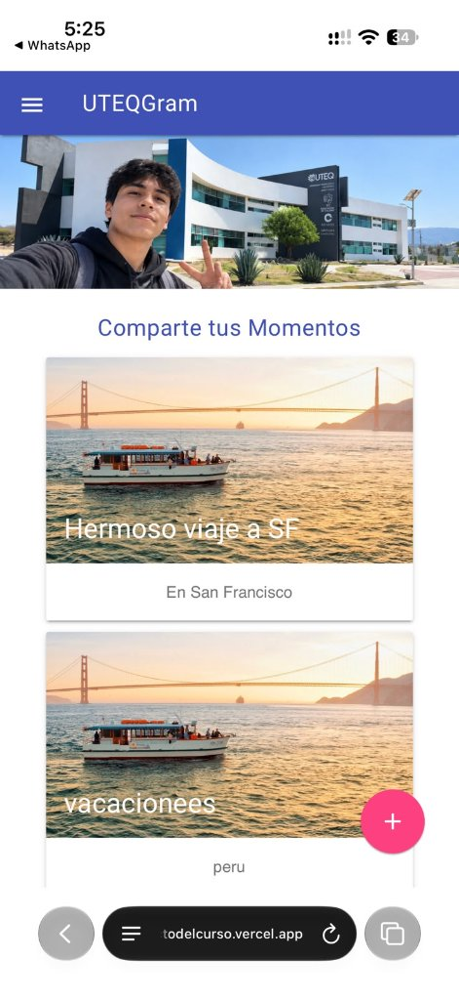
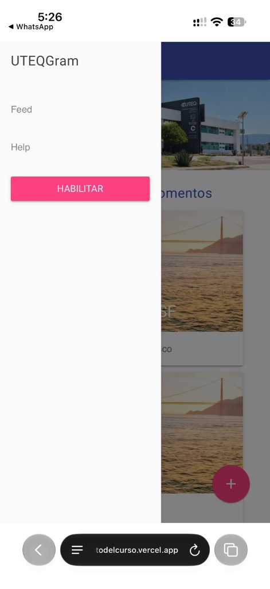
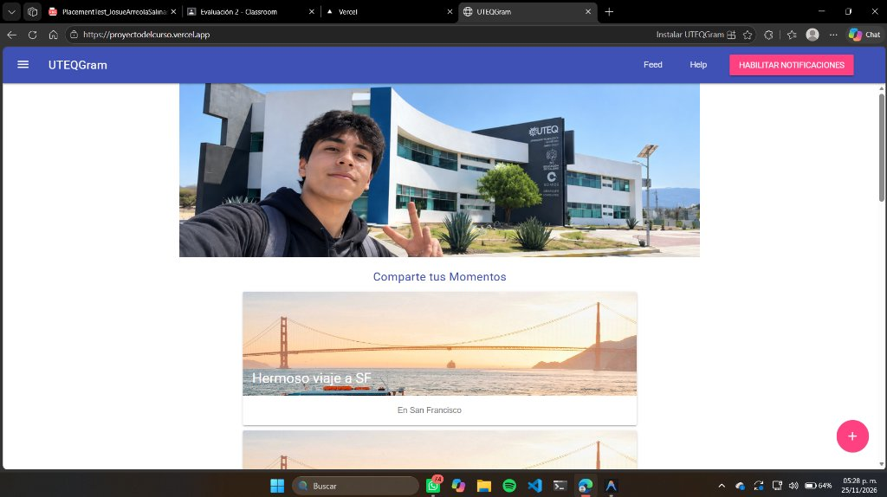
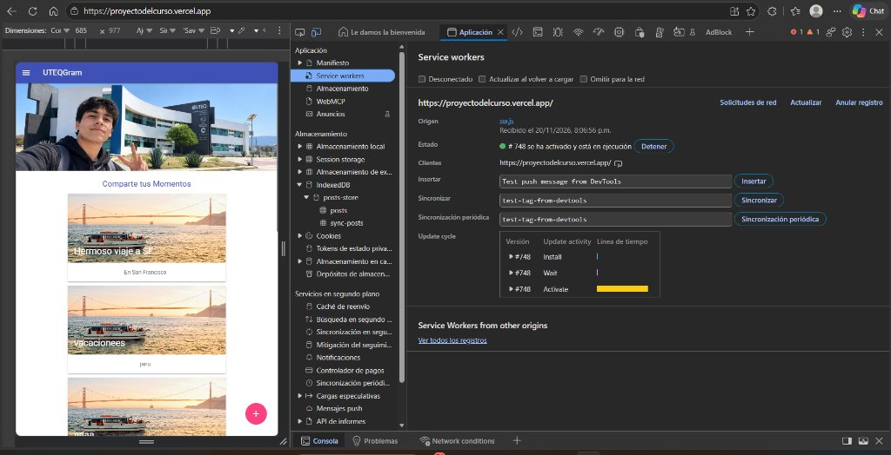
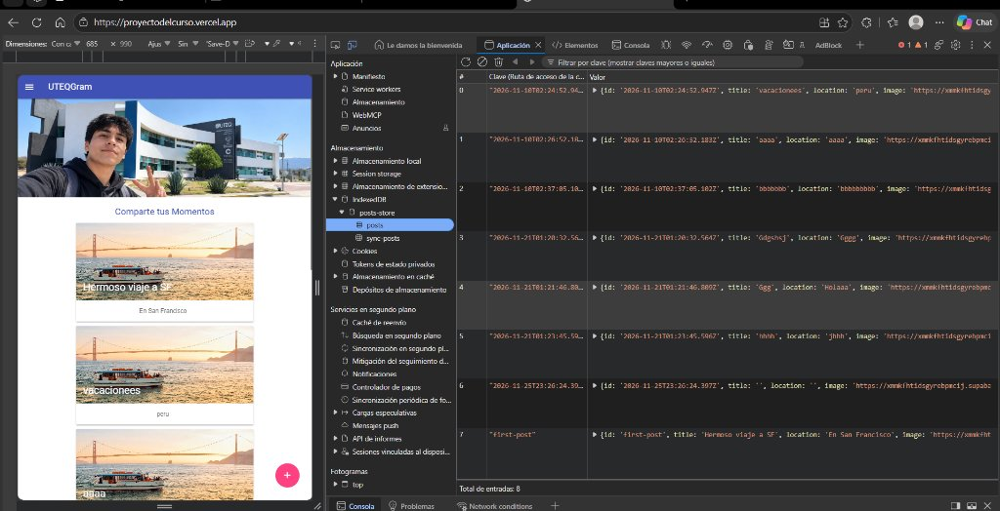
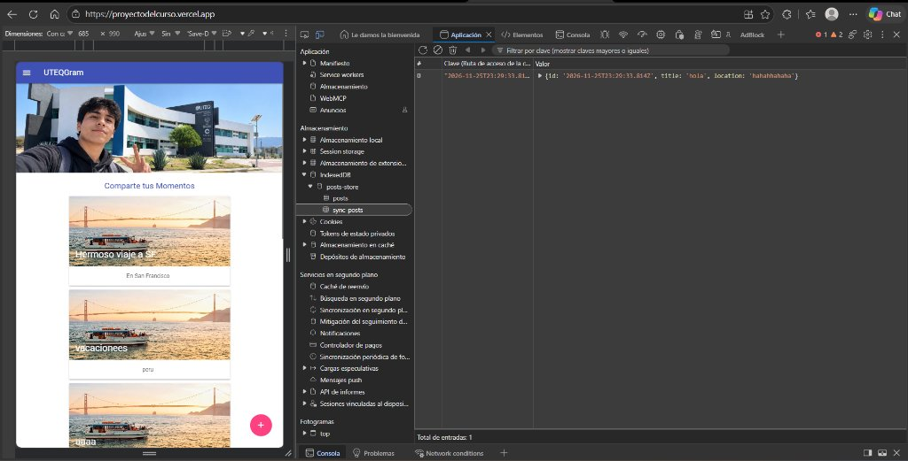
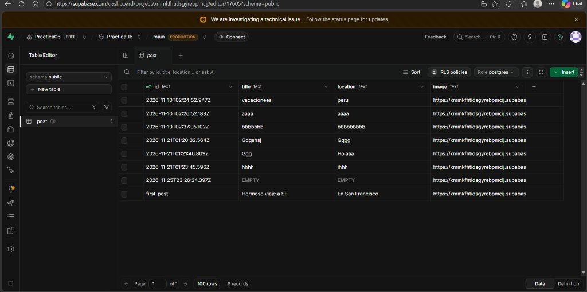

# UTEQGram - Progressive Web App (PWA)

Aplicación Web Progresiva para la comunidad estudiantil de la Universidad Tecnológica de Querétaro (UTEQ), diseñada bajo el paradigma **Offline-First**, con sincronización en segundo plano (Background Sync), almacenamiento local estructurado en IndexedDB y persistencia remota mediante Supabase.

---

## 🔗 Enlaces del Proyecto

* **🌐 Aplicación Web Publicada (Producción):** [https://proyectodelcurso.vercel.app](https://proyectodelcurso.vercel.app)
* **📂 Repositorio de Código Fuente (GitHub):** [https://github.com/josuearreola/proyecto_del_curso](https://github.com/josuearreola/proyecto_del_curso)

---

## 📱 Caso de Estudio

**UTEQGram** resuelve la problemática de conectividad intermitente que experimentan los estudiantes en áreas con baja cobertura celular o saturación de redes dentro del campus universitario. La plataforma permite a los usuarios:
1. Explorar publicaciones del campus incluso sin acceso a internet gracias a la caché de Service Workers y almacenamiento en IndexedDB.
2. Crear nuevas publicaciones mientras están desconectados; las publicaciones se encolan localmente en el almacén `sync-posts`.
3. Sincronizar automáticamente las publicaciones pendientes con la base de datos central en Supabase en el momento en que se restablece la conexión a la red (Background Sync).
4. Instalar la aplicación en dispositivos móviles (Android/iOS) y equipos de escritorio directamente desde el navegador web como una PWA independiente sin necesidad de tiendas de aplicaciones.

---

## 🛠️ Justificación de Plataformas y Herramientas

| Herramienta / Plataforma | Tipo | Justificación Técnica |
| :--- | :--- | :--- |
| **HTML5 / CSS3 / JavaScript (ES6)** | Frontend | Estándares web abiertos de alto rendimiento, compatibles con todos los navegadores modernos sin dependencias pesadas. |
| **Material Design Lite (MDL)** | Framework UI | Implementación ligera de los principios de diseño de Google, adaptada para móviles y escritorio con componentes responsivos (cards, drawers, snackbars). |
| **Service Worker API** | API del Navegador | Actúa como proxy de red entre el navegador y el servidor, gestionando el ciclo de vida de la aplicación, intercepción de peticiones HTTP y eventos en segundo plano. |
| **IndexedDB (`idb.js`)** | Almacenamiento Local | Base de datos NoSQL transaccional en el cliente para persistir objetos JSON estructurados (`posts` y `sync-posts`). |
| **Background Sync API** | Sincronización | Garantiza que las peticiones creadas offline se completen de manera diferida y resiliente en segundo plano. |
| **Supabase** | Backend as a Service | Base de datos PostgreSQL escalable accesible vía API RESTful segura con soporte de políticas de acceso y almacenamiento de archivos multimedia (Storage). |
| **Vercel** | Hosting & CI/CD | Despliegue continuo con HTTPS obligatorio (requisito fundamental de Service Workers), CDN global y alto rendimiento en la entrega de activos estáticos. |
| **Git & GitHub** | Control de Versiones | Gestión de código colaborativo, control de versiones y disparador de compilaciones automatizadas hacia Vercel. |

---

## ⚙️ Parámetros de Configuración

### 1. Despliegue en Vercel (`vercel.json`)
```json
{
  "outputDirectory": "public",
  "cleanUrls": true
}
```
* **`outputDirectory`:** Define que los archivos estáticos de la aplicación se sirven directamente desde el directorio `public/`.
* **`cleanUrls`:** Permite resolver rutas limpias sin extensiones `.html` (por ejemplo `/help`).

### 2. Manifiesto de la Aplicación (`manifest.json`)
```json
{
  "name": "UTEQGram",
  "short_name": "UTEQGram",
  "description": "App sencilla parecida a Instagram para compartir momentos",
  "start_url": "/",
  "scope": "/",
  "display": "standalone",
  "orientation": "portrait-primary",
  "background_color": "#ffffff",
  "theme_color": "#3f51b5",
  "icons": [
    {
      "src": "/src/images/icons/icon-192x192.png",
      "type": "image/png",
      "sizes": "192x192",
      "purpose": "any"
    },
    {
      "src": "/src/images/icons/icon-512x512.png",
      "type": "image/png",
      "sizes": "512x512",
      "purpose": "any"
    },
    {
      "src": "/src/images/icons/icon-512x512-maskable.png",
      "type": "image/png",
      "sizes": "512x512",
      "purpose": "maskable"
    }
  ]
}
```

### 3. Estrategia de Caché en el Service Worker (`sw.js`)
* **Versión de caché:** `static-v10` y `dynamic-v10`.
* **Estrategia estática (App Shell):** *Cache-First* para archivos estructurales HTML, CSS, JS, imágenes de interfaz e iconos.
* **Estrategia dinámica:** *Network-First* con almacenamiento en caché dinámico para nuevas páginas y recursos consultados.
* **API REST Supabase:** *Network-First* con respaldo en la base de datos local IndexedDB (`posts`).
* **Sincronización en Segundo Plano:**
  ```javascript
  self.addEventListener('sync', function (event) {
    if (event.tag === 'sync-new-posts') {
      event.waitUntil(
        readAllData('sync-posts')
          .then(function (data) {
            return Promise.all(data.map(function (post) {
              return fetch(SUPABASE_URL + '/rest/v1/post', { ... })
                .then(function (res) {
                  if (res.ok) {
                    return deleteItemFromData('sync-posts', post.id);
                  }
                });
            }));
          })
      );
    }
  });
  ```

---

## 📊 Vistas y Manejo de Datos

### Vistas generadas del lado del cliente (CSR)
La aplicación utiliza renderizado del lado del cliente (Client-Side Rendering):
* **Home / Feed principal (`index.html`):** Construcción dinámica de tarjetas mediante JavaScript (`feed.js`) al iterar los datos devueltos por el backend o leídos de IndexedDB.
* **Menú lateral responsive:** Cajón de navegación accesible tanto en versión móvil como en escritorio.
* **Modal de creación:** Formulario flotante para ingresar título y ubicación de una nueva publicación.
* **Página de soporte offline (`offline.html`):** Vista de respaldo ofrecida por el Service Worker cuando un recurso solicitado no se encuentra en caché y no hay conexión a internet.

### Manejo de Datos (Locales, Remotos y Offline)
* **Datos Remotos:** Servidos vía API RESTful desde Supabase (`/rest/v1/post?select=*`).
* **Datos Locales (Caché):** Almacén `posts` en IndexedDB sincronizado con las publicaciones recuperadas de la red para lectura instantánea sin conexión.
* **Datos Offline en cola:** Almacén `sync-posts` en IndexedDB donde se encolan las publicaciones creadas sin conexión hasta que el Service Worker active el evento `sync`.

---

## 🧪 Reporte de Pruebas

| ID | Caso de Prueba | Procedimiento | Resultado Esperado | Estado |
| :---: | :--- | :--- | :--- | :---: |
| **CP-01** | Despliegue HTTPS en producción | Abrir `https://proyectodelcurso.vercel.app` en Chrome/Edge. | Certificado SSL válido, carga inmediata del App Shell. | **EXITOSO** |
| **CP-02** | Registro de Service Worker | Inspeccionar en DevTools -> pestaña Application -> Service Workers. | Estado `#748 activado y en ejecución` con alcance `/`. | **EXITOSO** |
| **CP-03** | Instalación como PWA en Escritorio | Clic en el botón "Instalar UTEQGram" en la barra de direcciones del navegador. | Ventana independiente sin barra de navegación del navegador (standalone). | **EXITOSO** |
| **CP-04** | Instalación como PWA en Móvil | Ingresar a la URL desde navegador Android/iOS y seleccionar "Instalar aplicación". | Se agrega el icono con splash screen a la pantalla principal. | **EXITOSO** |
| **CP-05** | Persistencia local en IndexedDB | Inspeccionar IndexedDB -> `posts-store` -> `posts`. | Los registros descargados de Supabase se persisten localmente (8 entradas). | **EXITOSO** |
| **CP-06** | Creación de post sin conexión (Offline) | Activar modo avión o simular "Offline" en DevTools y enviar formulario de publicación. | El post se guarda en IndexedDB -> `sync-posts` y se registra `sync-new-posts`. | **EXITOSO** |
| **CP-07** | Sincronización en segundo plano (Sync) | Restablecer la conexión a internet. | El Service Worker dispara el evento `sync`, envía los datos a Supabase y limpia `sync-posts`. | **EXITOSO** |

---

## 📷 Evidencias Fotográficas

### 1. Vista Home en Dispositivo Móvil


### 2. Menú de Navegación Lateral (Drawer)


### 3. Aplicación en Escritorio con Opción de Instalación PWA


### 4. Service Worker Activo y en Ejecución


### 5. Almacenamiento Local en IndexedDB (`posts`)


### 6. Cola de Publicaciones Offline en IndexedDB (`sync-posts`)


### 7. Base de Datos en Supabase (Persistencia Remota)

